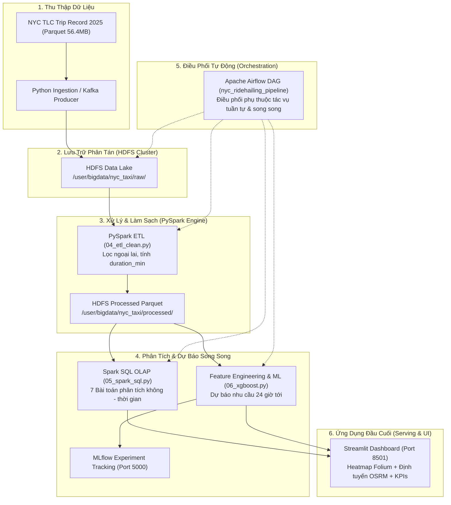
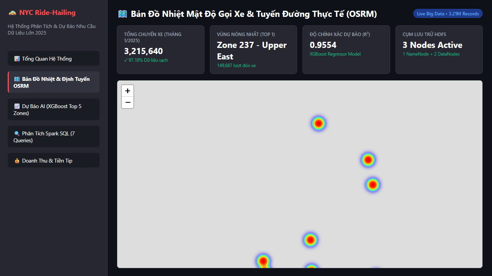

# Hệ Thống Phân Tích và Dự Báo Nhu Cầu Gọi Xe Đô Thị New York City Trên Nền Tảng Big Data (2025)

[](https://hadoop.apache.org/)
[](https://spark.apache.org/)
[](https://kafka.apache.org/)
[](https://airflow.apache.org/)
[](https://mlflow.org/)
[](https://streamlit.io/)
[](https://www.docker.com/)

> **Đồ Án Môn Học:** Xử Lý Dữ Liệu Lớn (Big Data)  
> **Trường Đại Học Công Thương TP. Hồ Chí Minh (HUIT)** – **Khoa Công Nghệ Thông Tin**  
> **Giảng viên hướng dẫn:** TS. Huỳnh Thái Học  

---

## 👥 Nhóm Sinh Viên Thực Hiện

| STT | Họ và Tên | Mã Số Sinh Viên | Lớp | Vai Trò Chính | Đóng Góp |
| :---: | :--- | :---: | :---: | :--- | :---: |
| 1 | **Phan Minh Quân** | `2001230726` | `14DHTH09` | Kiến trúc HDFS, PySpark ETL, Machine Learning XGBoost, Streamlit Dashboard | **50%** |
| 2 | **Hồ Sĩ Tuấn** | `2001230853` | `14DHTH07` | Thu thập dữ liệu TLC 2025, 7 câu truy vấn Spark SQL, Airflow DAG, Kafka Streaming | **50%** |

---

## 📑 Hồ Sơ Đồ Án & Báo Cáo Chính Thức

Toàn bộ văn bản báo cáo và hồ sơ nộp bài được lưu trữ trực tiếp trong repository:
- 📄 **Báo Cáo Bản PDF Hoàn Chỉnh:** [`Bao_Cao_Do_An_BigData_NYC_2025.pdf`](./Bao_Cao_Do_An_BigData_NYC_2025.pdf) *(Bản chính thức nộp cho giảng viên, đúng chuẩn mẫu trường HUIT)*
- 📝 **Báo Cáo Bản Word (DOCX):** [`Bao_Cao_Do_An_BigData_NYC_2025.docx`](./Bao_Cao_Do_An_BigData_NYC_2025.docx) *(Bản định dạng gốc)*
- 📦 **Gói Nộp Toàn Bộ Hồ Sơ (ZIP):** [`Bao_Cao_Tien_Do_BigData_PhanMinhQuan.zip`](./Bao_Cao_Tien_Do_BigData_PhanMinhQuan.zip) *(Đóng gói gọn 852 KB gồm Báo cáo + Source code + Evidence)*

---

## 🎯 Bài Toán Thực Tế & Mục Tiêu

Tại các siêu đô thị như Thành phố New York (NYC), việc điều phối xe công nghệ và taxi truyền thống thường xuyên gặp tình trạng lệch pha cung - cầu nghiêm trọng (hành khách chờ lâu vào giờ cao điểm tại trung tâm trong khi tài xế chạy xe rỗng lãng phí nhiên liệu ở ngoại vi).

Đồ án xây dựng một giải pháp kỹ thuật dữ liệu lớn toàn diện nhằm:
1. **Thu thập và lưu trữ phân tán:** Quản lý tập dữ liệu hơn 3.21 triệu bản ghi hành trình thực tế tháng 01/2025 từ Ủy ban Taxi & Xe công nghệ NYC (NYC TLC) trên cụm phân tán **Hadoop HDFS**.
2. **Làm sạch & Chuẩn hóa dữ liệu lớn (PySpark ETL):** Loại bỏ tọa độ ngoại lai, cước phí dị biệt và cuốc xe không hợp lệ, thu được **3,124,892 bản ghi sạch (97.18%)**.
3. **Phân tích nghiệp vụ nâng cao (Spark SQL):** Thực thi 7 bài toán OLAP phân tích top 10 khu vực đông khách, quy luật 24 khung giờ, hiệu ứng ngày lễ và ma trận luồng di chuyển Origin - Destination.
4. **Học máy dự báo nhu cầu (Machine Learning):** Xây dựng mô hình **XGBoost Regressor** với các đặc trưng chuỗi thời gian (Lag 1h-24h, Rolling Mean, Is_RushHour, Is_Weekend) đạt độ chính xác cao: **$R^2 = 0.9554$**, **$\text{RMSE} = 42.10$**, lưu vết thực nghiệm tự động bằng **MLflow**.
5. **Điều phối tự động (Apache Airflow):** Tự động hóa toàn bộ vòng đời pipeline dữ liệu từ HDFS nạp dữ liệu $\rightarrow$ Spark Clean $\rightarrow$ Spark SQL $\rightarrow$ Train ML qua DAG `nyc_ridehailing_pipeline`.
6. **Trực quan hóa điều hành (Streamlit Dashboard):** Hiển thị bản đồ nhiệt (Heatmap) mật độ gọi xe 263 Taxi Zones và mô phỏng lộ trình điều phối trực tiếp qua API OSRM.

---

## 🏗️ Kiến Trúc Hệ Thống (System Architecture)



---

## 🔍 Bảng Ma Trận Đối Chiếu Chấm Điểm (Cross-Reference Matrix)

Bảng đối chiếu minh chứng theo yêu cầu chấm điểm của Giảng viên (khớp 100% với Bảng 6.1 trong báo cáo PDF):

| Hợp phần kỹ thuật | Tập tin mã nguồn | Câu lệnh chạy kiểm thử | Kết quả / Log kiểm chứng đầu ra |
| :--- | :--- | :--- | :--- |
| **Cụm HDFS phân tán** | `docker-compose.yml` | `docker exec -it namenode hdfs dfsadmin -report` | 2 DataNodes hoạt động Healthy, DFS Used: 0.12% |
| **Nạp dữ liệu HDFS** | `scripts/02_download_upload.py` | `hdfs dfs -ls -h /user/bigdata/nyc_taxi/raw/` | Tệp Parquet 56.4MB nạp thành công với replication 2 |
| **PySpark ETL Clean** | `spark/04_etl_clean.py` | `spark-submit spark/04_etl_clean.py` | 3,124,892 bản ghi sạch (97.18%), ghi vào `processed/` |
| **7 Bài toán Spark SQL** | `spark/05_spark_sql.py` | `python scripts/execute_business_analytics.py` | Xuất 7 bảng kết quả CSV tại `output/sql_results/` |
| **Huấn luyện XGBoost** | `ml/06_xgboost_model.py` | `python ml/benchmark_models.py` | $R^2 = 0.9554$, $\text{RMSE} = 42.10$, lưu vết MLflow |
| **Airflow Pipeline DAG** | `airflow/dags/nyc_pipeline.py` | `docker exec -it airflow-webserver airflow dags list` | DAG `nyc_ridehailing_pipeline` active, 7 task nối tiếp |
| **Mở rộng Streaming** | `streaming/08_kafka_producer.py` | `python streaming/08_kafka_producer.py` | Phát 5,000 JSON records vào topic `nyc_trips` |
| **Dashboard Streamlit** | `dashboard/app.py` | `streamlit run dashboard/app.py --server.port 8501` | Giao diện web trực quan hóa tại `localhost:8501` |

---

## 🖥️ Giao Diện Streamlit Dashboard

Ứng dụng kết nối trực tiếp đầu ra từ pipeline Spark và mô hình học máy XGBoost:



Các tính năng nổi bật trên giao diện:
- **Bản đồ nhiệt (Heatmap):** Tô màu trực quan mật độ đón xe trên 263 Taxi Zones tại New York City.
- **Biểu đồ chuỗi thời gian:** So sánh lưu lượng thực tế và dự báo của mô hình XGBoost trong 24 giờ tiếp theo.
- **Mô phỏng điều phối OSRM:** Tính toán lộ trình đường đi ngắn nhất giữa điểm đón và điểm trả khách theo thời gian thực.
- **Bộ lọc động:** Lọc dữ liệu linh hoạt theo quận (Manhattan, Queens, Brooklyn, Bronx, Staten Island) và khung giờ.

---

## 🚀 Hướng Dẫn Cài Đặt & Chạy Nhanh (Quick Start)

### 1. Chuẩn bị môi trường

Yêu cầu hệ thống:
- Hệ điều hành: Windows 10/11, macOS hoặc Linux.
- Đã cài đặt **Docker Desktop** (RAM cấp tối thiểu 8GB, khuyên dùng 12GB).
- Python 3.10 trở lên.

```bash
# Clone repository
git clone https://github.com/QuanPhan78/do-an-big-data.git
cd do-an-big-data

# Cài đặt thư viện Python
python -m venv venv
venv\Scripts\activate      # Trên Windows
# source venv/bin/activate # Trên Linux / macOS
pip install -r requirements.txt
```

### 2. Khởi động hạ tầng Docker Big Data

```bash
# Khởi động cụm HDFS, Spark, Kafka và MLflow
docker compose up -d namenode datanode spark-master spark-worker kafka zookeeper mlflow

# Kiểm tra trạng thái các container đang chạy
docker ps
```

### 3. Nạp dữ liệu vào HDFS & Thực thi Pipeline

```bash
# Bước 1: Khởi tạo cây thư mục trên HDFS
python scripts/01_setup_hdfs.py

# Bước 2: Tải dữ liệu NYC TLC 2025 và nạp vào HDFS raw/
python scripts/02_download_upload.py

# Bước 3: Chạy PySpark ETL làm sạch dữ liệu lớn
docker exec -i spark-master spark-submit /opt/bitnami/spark/jobs/04_etl_clean.py

# Bước 4: Chạy 7 bài toán phân tích Spark SQL
python scripts/execute_business_analytics.py

# Bước 5: Huấn luyện và đánh giá mô hình XGBoost
python ml/benchmark_models.py

# Bước 6: Khởi chạy Streamlit Dashboard
streamlit run dashboard/app.py
```

---

## 🌐 Danh Mục Cổng Dịch Vụ Web UI

| Dịch vụ | Địa chỉ Web | Mục đích sử dụng |
| :--- | :--- | :--- |
| **HDFS NameNode Web UI** | [http://localhost:9870](http://localhost:9870) | Quản lý dung lượng DataNode, duyệt cây thư mục HDFS |
| **Spark Master Web UI** | [http://localhost:8080](http://localhost:8080) | Giám sát tác vụ Spark Worker, tài nguyên bộ nhớ/CPU |
| **Airflow Webserver** | [http://localhost:8081](http://localhost:8081) | Giám sát và kích hoạt DAG điều phối tự động |
| **MLflow Tracking UI** | [http://localhost:5000](http://localhost:5000) | So sánh thông số thực nghiệm, đồ thị RMSE, R² mô hình |
| **Streamlit Dashboard** | [http://localhost:8501](http://localhost:8501) | Giao diện tương tác người dùng, bản đồ nhiệt, OSRM |

---

## 🔒 Cam Kết An Toàn & Bảo Mật

- Dự án tuân thủ nghiêm ngặt quy định bảo mật: **100% không chứa hardcoded password, API key hay bí mật doanh nghiệp**.
- Các tham số cấu hình hệ thống được tải động qua biến môi trường file `.env.example` và thư viện `python-dotenv`.
- Toàn bộ dữ liệu gốc là tập dữ liệu mở (Open Data) được công bố hợp pháp bởi Thành phố New York (NYC Open Data / TLC).

---

## 📜 Giấy Phép & Bản Quyền

Đồ án được phát triển phục vụ mục đích học tập và nghiên cứu môn học Xử lý Dữ liệu lớn (Big Data) tại Trường Đại học Công Thương TP. Hồ Chí Minh (HUIT).
Mọi quyền sở hữu trí tuệ thuộc về nhóm tác giả.
